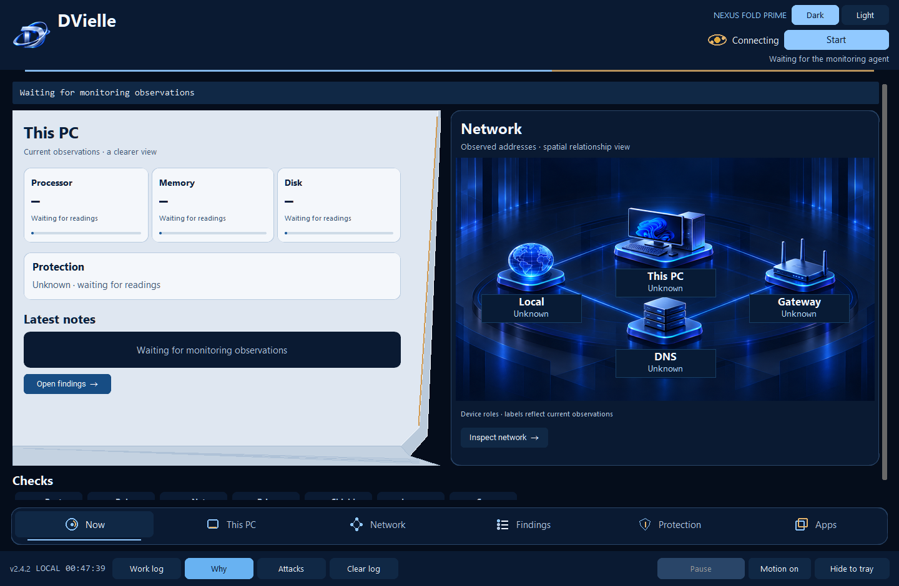
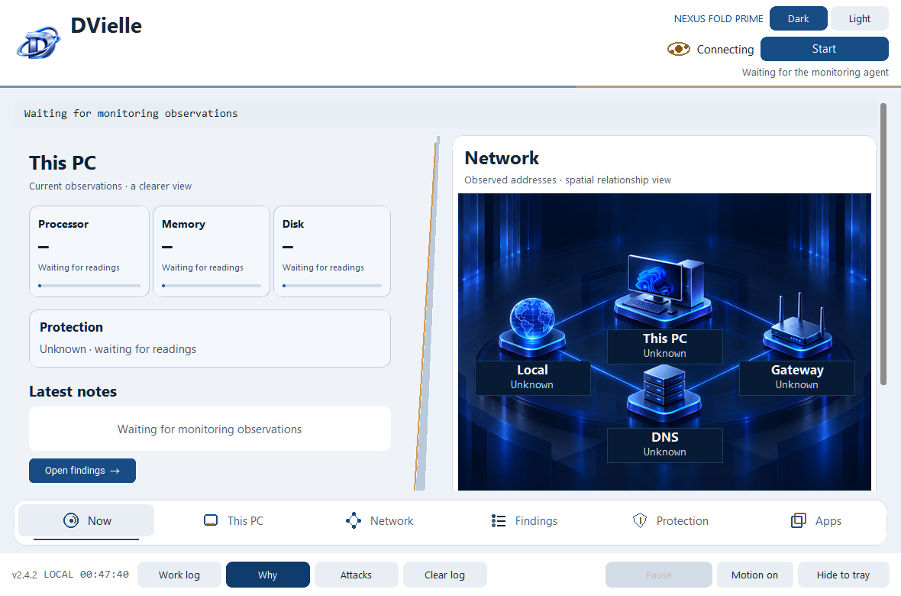

<p align="center">
  
</p>

<h1 align="center">D'Vielle</h1>
<p align="center"><strong>Intelligent Vigilance</strong> &middot; a free, local guardian for your Windows PC</p>

<p align="center">
  <a href="https://github.com/DVILLIE/VIGILLANCE/releases/latest"></a>
  <a href="LICENSE"></a>
  
  
  <a href="CHANGELOG.md"></a>
</p>

D'Vielle watches the computer it is installed on, explains what it noticed in plain language, and shows you options. It changes the PC only after you choose. Every finding is a ticket: **Found &rarr; Fix &rarr; Resolved** (or still monitoring). Unknown stays unknown, and a partial check is labelled partial.

Current implementation, verified installed scope and remaining release acceptance: [2026-10-12 acceptance plan](docs/implementation/CURRENT_ACCEPTANCE_AND_IMPLEMENTATION_PLAN_2026-10-12.md).

Package `dvielle` **2.5.0** &middot; [What's new](CHANGELOG.md) &middot; [Releases](https://github.com/DVILLIE/VIGILLANCE/releases) &middot; MIT licensed

## Nexus Fold Prime theme and Quantum Key logo

| Nexus Fold Prime &mdash; Dark | Nexus Fold Prime &mdash; Light |
|---|---|
|  |  |

- **Nexus Fold Prime** is the console theme: a pearl folded overview, a cobalt spatial network stage and a bottom dock across all six pages, in Dark and Light. Motion follows the Windows animation setting unless you choose otherwise, and it can be switched off. Animation is decoration only; it never stands in for a measurement. Details: [docs/NEXUS_FOLD_PRIME.md](docs/NEXUS_FOLD_PRIME.md).
- **Quantum Key** is the logo: a cube circuit with silent blue electrical surges in the header, and a matching static mark for the window, taskbar, tray and shortcuts. Assets: [assets/brand](assets/brand/README.md).

<p align="center"></p>

The screenshots are real console widgets rendered with monitoring stopped. They are not live Windows readings.

## Highlights in 2.5.0

- **Scoped protection helper.** An optional Windows service, *D'Vielle Scoped Protection Helper* (`DViellePrivilegedHelper`), runs as LocalSystem so a per-app network restriction you approved can be applied without making the whole agent elevated. It accepts one defined operation (`restrict_network`) over an authenticated local named pipe, only with a one-time protected grant, and refuses everything else. The resident monitor itself stays Limited.
- **Firewall rollback journal**, plus journalled ASR and Controlled Folder Access changes, so what D'Vielle changed can be undone.
- **Assessment engine and Quantum readiness tab.** A consent-based local assessment of this PC (process identity, signatures, dependencies, certificates, TLS key exchange, attack paths) with a post-quantum readiness view.
- **Hardening.** Windows Sandbox launch checks, threat-intel fetch and matching fixes, offline-update recovery, database claims and safer path handling.
- **Runtime and install.** Protected Python 3.14 runtime and a default install location of `C:\Program Files\DVielle`.

Full list: [CHANGELOG.md](CHANGELOG.md).

## What it does

On the PC where you install it, D'Vielle:

1. **Observes** processor, memory, disk, network path, sign-in failures, privacy settings, and Windows security posture (including Defender, where Windows allows the read).
2. **Explains** in ordinary language, with the evidence behind **Why**.
3. **Offers options** when something looks wrong or unexpected.
4. **Acts after you choose**: close an app, change one supported setting, restrict an app's network access, or open an unfamiliar folder in Windows Sandbox, only when you picked that option and a second check agrees. If either check refuses, nothing is changed.

You can mark an app or a setting as **OK to keep on**. While it still matches, D'Vielle stays quiet.

## What it is not

- **Not an antivirus replacement.** It works alongside Microsoft Defender, never turns real-time protection off, and never adds a Defender exclusion for itself.
- **Not an attack tool.** No exploit kits, no password capture, no scanning of other people's machines. Scope is this PC.
- **Not a chat assistant.** Chat was removed in 2.3.3. See [docs/CHAT_REMOVED.md](docs/CHAT_REMOVED.md).
- **Not a promise of a clean PC.** It cannot prove the machine is free of threats. Written limits: [docs/CLAIMS.md](docs/CLAIMS.md).

## Supported systems

| | |
|--|--|
| **Primary** | Windows 10 or 11, 64-bit, laptop or desktop. Python 3.14 (protected system install). |
| **Limited** | Linux and macOS run shared keep-on logic only; Windows sensors stay unavailable and there is no installer. |
| **Not this product** | Cloud servers, SaaS dashboards, or watching another machine. Install it on the PC you want watched. |

Windows Home and Pro are both in scope. Home does not get Windows Sandbox or App Control authoring, and the console says so.

## Download and install

**2.5.0 is published as source.** The 2.5.0 installer is staged from a verified, protected copy of the source, and the setup wrapper (`DVielle-Setup-*.exe`) stays held until protected bootstrap staging is finished. Follow [installer/INSTALL.txt](installer/INSTALL.txt) and [docs/WINDOWS_INSTALLER.md](docs/WINDOWS_INSTALLER.md).

| Release | Files |
|---------|-------|
| [v2.5.0](https://github.com/DVILLIE/VIGILLANCE/releases/tag/v2.5.0) (latest) | `DVielle-2.5.0-source.zip` and the GitHub source archives. `DVielle-Setup-2.5.0.exe` is **Not on this Release**: the wrapper is held, and it is not a PyInstaller freeze of the agent. |
| [v2.4.0](https://github.com/DVILLIE/VIGILLANCE/releases/tag/v2.4.0) (last packaged installer, Python 3.12) | [DVielle-2.4.0-windows-installer.zip](https://github.com/DVILLIE/VIGILLANCE/releases/download/v2.4.0/DVielle-2.4.0-windows-installer.zip) &middot; [DVielle-2.4.0-windows-source.zip](https://github.com/DVILLIE/VIGILLANCE/releases/download/v2.4.0/DVielle-2.4.0-windows-source.zip) &middot; [DVielle-Setup-2.4.0.exe](https://github.com/DVILLIE/VIGILLANCE/releases/download/v2.4.0/DVielle-Setup-2.4.0.exe) |

| Action | From the install folder (default `C:\Program Files\DVielle`) |
|--------|---------------------------------------------------------------|
| Open the console | Desktop shortcut **D'Vielle - Intelligent Vigilance**, `installer\Launch-DVielle.bat`, or `.venv\Scripts\DVielle.exe -m dvielle` |
| One observe-only pass | `.venv\Scripts\python.exe -m agent.main --once` |
| Stop the agent | `.venv\Scripts\python.exe -m agent.main --stop` |
| Uninstall | `installer\Uninstall-DVielle.bat` (as administrator) |

The resident scheduled task stays **Limited** (your normal rights). The installer refuses an always-elevated task.

> File, folder, task and package names keep the compatible `DVielle` / `dvielle` spelling (for example `DVielle.exe` and `C:\Program Files\DVielle`) so existing installs keep working. The product name is D'Vielle.

## Privacy

Local-first. Notes, keep-on choices, assessment results and the theme file stay on this PC. Public-IP lookup is off unless you turn it on. Core monitoring does not call a model or upload snapshots. Home and Pro diagnostic-data limits: [docs/TELEMETRY_AND_HOME.md](docs/TELEMETRY_AND_HOME.md).

## Documentation

| Doc | Purpose |
|-----|---------|
| [CHANGELOG.md](CHANGELOG.md) | Release history |
| [docs/USER_GUIDE.md](docs/USER_GUIDE.md) | Install, first open, theme, notes, uninstall |
| [docs/NEXUS_FOLD_PRIME.md](docs/NEXUS_FOLD_PRIME.md) | Nexus Fold Prime theme |
| [docs/REPAIR_INSTALL_PRIVILEGE_BOUNDARY.md](docs/REPAIR_INSTALL_PRIVILEGE_BOUNDARY.md) | Install and helper privilege boundary |
| [docs/FUNCTION_SPEC.md](docs/FUNCTION_SPEC.md) | Pillars, what shipped, honesty limits |
| [docs/CLAIMS.md](docs/CLAIMS.md) | Promises, assumptions, what stays unchecked |
| [docs/TRUST_GATES.md](docs/TRUST_GATES.md) | Pass/fail checks |
| [docs/AUTONOMY.md](docs/AUTONOMY.md) | What the resident agent does on its own |
| [docs/project/](docs/project/00_DVielle_Project_Documentation_Master_Index.md) | Full project documentation set |
| [docs/implementation/](docs/implementation/AUDIT_FINDINGS_REPAIR_AND_ACCEPTANCE_2026-10-11.md) | Latest implementation and acceptance evidence |

## Development checks

```bat
py -3.14 -m pip install -e ".[windows,dev]"
py -3.14 scripts\smoke_test.py
py -3.14 -m pytest -q
```

Unit tests are not a substitute for a Windows install and a long run on a real PC. See [docs/DEV.md](docs/DEV.md).

## Author and contact

**Ravikant R. T. &middot; KT Trading System** &middot; [kt.tradingsystem@gmail.com](mailto:kt.tradingsystem@gmail.com)

MIT License. Copyright (c) 2026 Ravikant R. Tayade / KT Trading System. See [LICENSE](LICENSE).
